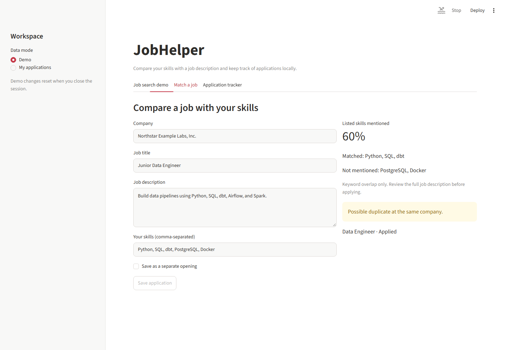

# JobHelper

JobHelper is a local job application tracker built with Python, Streamlit, and SQLite. It explains which of your skills are mentioned in a job description and flags likely duplicate applications before you save them.



## Try the demo

Use Python 3.11 or later.

```bash
python -m venv .venv
```

Activate the environment with `.\.venv\Scripts\Activate.ps1` in PowerShell or `source .venv/bin/activate` on macOS/Linux. Then run:

```bash
python -m pip install -r requirements.txt
python -m streamlit run app.py
```

Demo mode opens by default. In **Job search demo**, select **StepStone**, enter `Data Engineer` and `Berlin`, and click **Search sample jobs**. Copy a result into **Match a job** to see the skills found and an example duplicate warning. Try the sample Machine Learning Engineer posting to save a new application, then update its status in **Application tracker**.

All search results are fictional fixtures. Job board names are filter labels and the app has no affiliation with them. Search performs no external requests. The app does not sign in, scrape postings, or submit applications.

## How it works

- **Skill matching** counts the fraction of your listed skills mentioned in the description. It uses boundary-aware text matching and a small alias dictionary. The score measures keyword overlap and does not predict hiring outcomes.
- **Duplicate checks** compare normalized company names and core title tokens. Similar titles can refer to distinct openings, so you can choose to save one separately.
- **Application tracking** supports Saved, Applied, Interview, Offer, Rejected, and Withdrawn. Demo changes live in the current session. In **My applications** mode, records are stored in the local `data/applications.sqlite3` file, ignored by Git.

The app binds to localhost with Streamlit telemetry disabled. It requires neither an API key nor a job board account.

## Tests

```bash
python -m unittest discover -s tests -v
```

The tests cover skill boundaries, fixture filtering, duplicate detection, SQLite persistence, and the Streamlit demo flow. GitHub Actions runs the same suite on pushes and pull requests.
